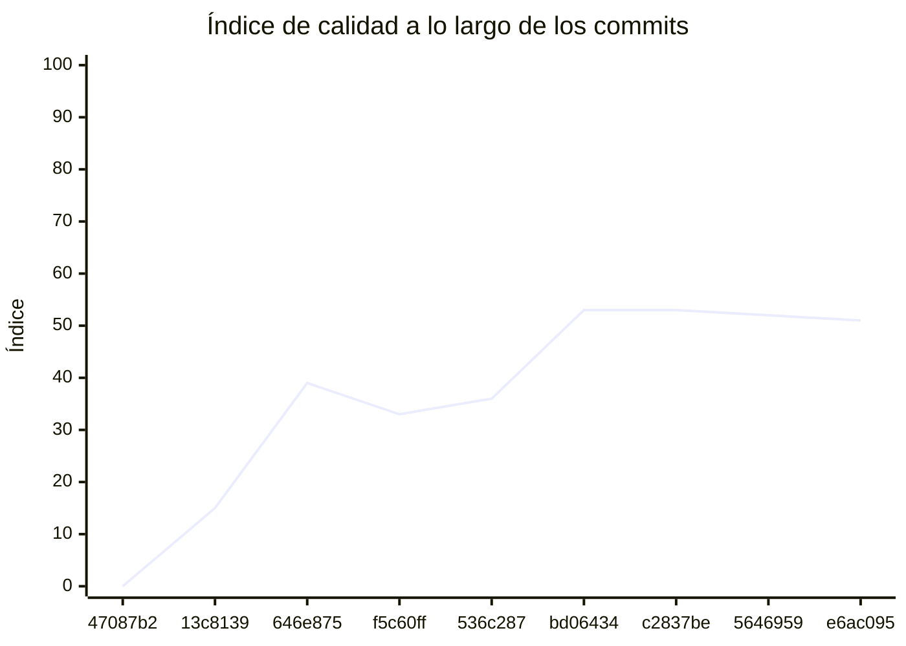

<!-- evaluacion:inicio -->
# Evaluación — TONEATTI-PROGRAMACION-TRABAJO-FINAL/Servicio-catalogo

> Documento **generado automáticamente** por la cátedra de Programación II (UM): RepoSense + análisis de calidad de **7 dimensiones**. **No editar a mano**: se regenera en cada evaluación.
> Rama evaluada: `main`. Análisis **heurístico** (regex + métricas) + build: es una criba para orientar la revisión, **no una nota**. La **documentación** del repositorio no se evalúa.
> Generado: 2026-11-11.

## 1. Veredicto

| Aspecto | Resultado |
|---|---|
| Índice de calidad | **62/100** |
| Tipo de repositorio | `backend` |
| Build (`mvnw verify` / `gradlew check`) | OK |
| Código (LOC) | 3,400 |
| Archivos de código | 115 |
| Clases | 119 |
| Código dentro de clases (%POO) | 66% |
| Funciones fuera de clases | 0 |
| Duplicación (puerta) | 1.3% |
| Duplicación lógica | 1.5% |
| Duplicación de boilerplate | 6.7% |
| Cobertura | 96% |
| Tope duro aplicado a D1 | `POO_BAJO` → D1 ≤ 60 |

> Este informe **describe** lo que el análisis midió con los criterios ya establecidos de la materia. No es una nota.

## 2. Semáforo de aprobación

Criterios de la cátedra (`CRITERIOS-CALIDAD.md`): **Aprobar** se juega con el perfil `estandar`; **destacar**, con el `exigente` (meta de excelencia).

| Semáforo | Resultado |
|---|---|
| Aprobar (`estandar`) | **no cumple** — 7/11 |
| Destacar (`exigente`) | **no cumple** — 4/11 |

**Para aprobar, falta cumplir:** SEC

**Para destacar, falta cumplir:** SOLID; POO; Duplicación; SEC

## 3. Autoría (RepoSense)

| Autor | Commits | Código (LOC) | Tests (LOC) | Docs (LOC) | Días activos | % del código |
|---|---:|---:|---:|---:|---:|---:|
| LucianoToneatti | 44 | 1,756 | 2,347 | 223 | 18 | 100% |

> _El LOC de autoría lo calcula RepoSense sobre el historial y puede diferir del LOC de código del análisis (que mira el estado de `main`)._

## 4. Dimensiones evaluadas

Cada dimensión indica **qué mide**, **por qué importa** y **tu resultado**. Cuando el puntaje queda por debajo de la referencia, se agregan preguntas para **investigar la causa** (no hay recetas).

| Dimensión | Peso | Puntaje |
|:--|--:|--:|
| **D1** Diseño OO, SOLID y patrones (20%) | 20% | 6 |
| **D2** Arquitectura hexagonal — backend (15%) | 15% | 100 |
| **D3** Frontend KMP: MVVM y buenas prácticas (10%) | 10% | N/A |
| **D4** Integración y contrato (10%) | 10% | 80 |
| **D5** Seguridad y robustez (10%) | 10% | 0 |
| **D6** Pruebas y cobertura (20%) | 20% | 100 |
| **D7** Proceso y entrega (15%) | 15% | 77 |

### D1. Diseño OO, SOLID y patrones (20%)

- **Qué mide:** Métricas orientadas a objetos (clases, métodos, campos, cohesión, acoplamiento, herencia) y proxies de SOLID, más patrones de diseño.
- **Por qué importa:** El eje de la materia es el buen uso de la POO y su arquitectura: un diseño con clases claras y poco acopladas es más fácil de entender, probar y cambiar.
- **Tu resultado:** **6/100**
- **Para investigar la causa:**
    - ¿Se pensó el modelo de clases antes de codificar o se agrupó después?
    - ¿Qué clases concentran muchas responsabilidades a la vez?
    - ¿Los colaboradores llegan como parámetros o se crean por dentro?

### D2. Arquitectura hexagonal — backend (15%)

- **Qué mide:** Separación en capas (dominio, puertos de entrada/salida, adaptadores) y dirección de las dependencias del backend.
- **Por qué importa:** Aislar el dominio de la infraestructura permite cambiar la base de datos, el framework o el transporte sin tocar las reglas de negocio.
- **Tu resultado:** **100/100**

### D4. Integración y contrato (10%)

- **Qué mide:** Cumplimiento del contrato de integración de la cátedra (formato de errores, paginación, autenticación, endpoints esperados).
- **Por qué importa:** Los servicios deben poder integrarse entre sí y con la app sin sorpresas; el contrato es lo que hacen cumplir las pruebas de integración.
- **Tu resultado:** **80/100**

### D5. Seguridad y robustez (10%)

- **Qué mide:** Credenciales embebidas, consultas SQL por concatenación, y presencia de config de entorno; aislamiento de secretos.
- **Por qué importa:** Un secreto en el repositorio o una consulta construida por concatenación son riesgos concretos, no hipotéticos.
- **Tu resultado:** **0/100**
- **Para investigar la causa:**
    - ¿De dónde salen las credenciales que usa el sistema?
    - ¿Qué consultas se arman con texto en vez de parámetros?
    - ¿Qué pasa si falta una variable de entorno al arrancar?

### D6. Pruebas y cobertura (20%)

- **Qué mide:** Cantidad y resultado de pruebas y cobertura de línea (JaCoCo/Kover, Surefire/Failsafe) cuando hay build.
- **Por qué importa:** Las pruebas son la red de seguridad para refactorizar e integrar; la cobertura acota las zonas sin verificar.
- **Tu resultado:** **100/100**

### D7. Proceso y entrega (15%)

- **Qué mide:** Artefactos verificables de proceso/entrega: `compose`, `.env.example`, CI (`.github/workflows/`), `CODEOWNERS` y wrapper de build (`mvnw`/`gradlew`). **No** puntúa documentación.
- **Por qué importa:** Un proyecto que compila, se levanta y se valida solo es más fácil de revisar y de integrar en equipo.
- **Tu resultado:** **77/100**

## 5. Señales detectadas

El análisis encontró las siguientes señales (archivo, sin número de línea a propósito):

**DIP/concretos** (29)
- clase 'JpaProfessionalRepositoryAdapter' muy acoplada (CBO=8) — `src/main/java/com/toneatti/catalogo/professional/infrastructure/persistence/adapter/JpaProfessionalRepositoryAdapter.java`
- clase 'ProfessionalController' muy acoplada (CBO=9) — `src/main/java/com/toneatti/catalogo/professional/infrastructure/web/controller/ProfessionalController.java`
- clase 'SnapshotOnStartupListener' muy acoplada (CBO=13) — `src/main/java/com/toneatti/catalogo/synchronization/infrastructure/startup/SnapshotOnStartupListener.java`
- clase 'CatedraSnapshotMapper' muy acoplada (CBO=10) — `src/main/java/com/toneatti/catalogo/synchronization/infrastructure/rest/mapper/CatedraSnapshotMapper.java`
- clase 'CatedraSnapshotMapper' instancia 4 concretos (CBO=10) — `src/main/java/com/toneatti/catalogo/synchronization/infrastructure/rest/mapper/CatedraSnapshotMapper.java`
- clase 'RestCatedraRepositoryAdapter' muy acoplada (CBO=19) — `src/main/java/com/toneatti/catalogo/synchronization/infrastructure/rest/adapter/RestCatedraRepositoryAdapter.java`
- clase 'RestCatedraRepositoryAdapter' instancia 4 concretos (CBO=19) — `src/main/java/com/toneatti/catalogo/synchronization/infrastructure/rest/adapter/RestCatedraRepositoryAdapter.java`
- clase 'ApplyCatalogSnapshotUseCaseImpl' muy acoplada (CBO=8) — `src/main/java/com/toneatti/catalogo/synchronization/application/usecases/ApplyCatalogSnapshotUseCaseImpl.java`
- clase 'JpaProfessionalCategoryRepositoryAdapter' muy acoplada (CBO=8) — `src/main/java/com/toneatti/catalogo/professionalcategory/infrastructure/persistence/adapter/JpaProfessionalCategoryRepositoryAdapter.java`
- clase 'JpaWeeklyScheduleRepositoryAdapter' muy acoplada (CBO=8) — `src/main/java/com/toneatti/catalogo/weeklyschedule/infrastructure/persistence/adapter/JpaWeeklyScheduleRepositoryAdapter.java`
- clase 'WeeklyScheduleEntity' muy acoplada (CBO=11) — `src/main/java/com/toneatti/catalogo/weeklyschedule/infrastructure/persistence/entity/WeeklyScheduleEntity.java`
- clase 'JpaProfessionalRepositoryAdapterTest' muy acoplada (CBO=8) — `src/test/java/com/toneatti/catalogo/professional/infrastructure/persistence/adapter/JpaProfessionalRepositoryAdapterTest.java`
- clase 'CatalogSnapshotFixtures' muy acoplada (CBO=9) — `src/test/java/com/toneatti/catalogo/synchronization/CatalogSnapshotFixtures.java`
- clase 'CatalogSnapshotSynchronizationIntegrationTest' muy acoplada (CBO=23) — `src/test/java/com/toneatti/catalogo/synchronization/CatalogSnapshotSynchronizationIntegrationTest.java`
- clase 'SnapshotOnStartupIntegrationTest' muy acoplada (CBO=20) — `src/test/java/com/toneatti/catalogo/synchronization/infrastructure/startup/SnapshotOnStartupIntegrationTest.java`
- clase 'CatedraSnapshotMapperTest' muy acoplada (CBO=14) — `src/test/java/com/toneatti/catalogo/synchronization/infrastructure/rest/mapper/CatedraSnapshotMapperTest.java`
- clase 'CatedraSnapshotMapperTest' instancia 6 concretos (CBO=14) — `src/test/java/com/toneatti/catalogo/synchronization/infrastructure/rest/mapper/CatedraSnapshotMapperTest.java`
- clase 'RestCatedraRepositoryAdapterTest' muy acoplada (CBO=38) — `src/test/java/com/toneatti/catalogo/synchronization/infrastructure/rest/adapter/RestCatedraRepositoryAdapterTest.java`
- clase 'RestCatedraRepositoryAdapterTest' instancia 4 concretos (CBO=38) — `src/test/java/com/toneatti/catalogo/synchronization/infrastructure/rest/adapter/RestCatedraRepositoryAdapterTest.java`
- clase 'ApplyCatalogSnapshotUseCaseImplTest' muy acoplada (CBO=17) — `src/test/java/com/toneatti/catalogo/synchronization/application/usecases/ApplyCatalogSnapshotUseCaseImplTest.java`
- clase 'JpaProfessionalCategoryRepositoryAdapterTest' muy acoplada (CBO=8) — `src/test/java/com/toneatti/catalogo/professionalcategory/infrastructure/persistence/adapter/JpaProfessionalCategoryRepositoryAdapterTest.java`
- clase 'BookableProfessionalIntegrationTest' muy acoplada (CBO=13) — `src/test/java/com/toneatti/catalogo/bookableprofessional/infrastructure/web/controller/BookableProfessionalIntegrationTest.java`
- clase 'JpaWeeklyScheduleRepositoryAdapterTest' muy acoplada (CBO=9) — `src/test/java/com/toneatti/catalogo/weeklyschedule/infrastructure/persistence/adapter/JpaWeeklyScheduleRepositoryAdapterTest.java`
- clase 'JpaWeeklyScheduleRepositoryAdapterReplaceAllTest' muy acoplada (CBO=9) — `src/test/java/com/toneatti/catalogo/weeklyschedule/infrastructure/persistence/adapter/JpaWeeklyScheduleRepositoryAdapterReplaceAllTest.java`
- clase 'WeeklyScheduleIntegrationTest' muy acoplada (CBO=8) — `src/test/java/com/toneatti/catalogo/weeklyschedule/infrastructure/web/controller/WeeklyScheduleIntegrationTest.java`
- clase 'FakeHttpServer' muy acoplada (CBO=34) — `src/test/java/com/toneatti/catalogo/support/FakeHttpServer.java`
- clase 'FakeHttpServer' instancia 8 concretos (CBO=34) — `src/test/java/com/toneatti/catalogo/support/FakeHttpServer.java`
- clase 'CatalogSyncPropertiesTest' muy acoplada (CBO=14) — `src/test/java/com/toneatti/catalogo/config/CatalogSyncPropertiesTest.java`
- clase 'CatedraIntegrationPropertiesTest' muy acoplada (CBO=18) — `src/test/java/com/toneatti/catalogo/config/CatedraIntegrationPropertiesTest.java`

**SRP/responsabilidad** (22)
- clase 'ProfessionalEntity' sin métodos (7 campos): solo datos — `src/main/java/com/toneatti/catalogo/professional/infrastructure/persistence/entity/ProfessionalEntity.java`
- clase 'ProfessionalResponse' sin métodos (5 campos): solo datos — `src/main/java/com/toneatti/catalogo/professional/infrastructure/web/dto/ProfessionalResponse.java`
- clase 'Professional' sin métodos (7 campos): solo datos — `src/main/java/com/toneatti/catalogo/professional/domain/model/Professional.java`
- clase 'SnapshotOnStartupListener' con baja cohesión (40%) — `src/main/java/com/toneatti/catalogo/synchronization/infrastructure/startup/SnapshotOnStartupListener.java`
- clase 'CatalogSyncStateEntity' sin métodos (5 campos): solo datos — `src/main/java/com/toneatti/catalogo/synchronization/infrastructure/persistence/entity/CatalogSyncStateEntity.java`
- clase 'ProfessionalCategoryEntity' sin métodos (6 campos): solo datos — `src/main/java/com/toneatti/catalogo/professionalcategory/infrastructure/persistence/entity/ProfessionalCategoryEntity.java`
- clase 'ProfessionalCategoryResponse' sin métodos (3 campos): solo datos — `src/main/java/com/toneatti/catalogo/professionalcategory/infrastructure/web/dto/ProfessionalCategoryResponse.java`
- clase 'ProfessionalCategory' sin métodos (6 campos): solo datos — `src/main/java/com/toneatti/catalogo/professionalcategory/domain/model/ProfessionalCategory.java`
- clase 'BookableProfessionalResponse' sin métodos (5 campos): solo datos — `src/main/java/com/toneatti/catalogo/bookableprofessional/infrastructure/web/dto/BookableProfessionalResponse.java`
- clase 'WeeklyScheduleEntity' grande (LOC=13, métodos=0, campos=9) — `src/main/java/com/toneatti/catalogo/weeklyschedule/infrastructure/persistence/entity/WeeklyScheduleEntity.java`
- clase 'WeeklyScheduleEntity' sin métodos (9 campos): solo datos — `src/main/java/com/toneatti/catalogo/weeklyschedule/infrastructure/persistence/entity/WeeklyScheduleEntity.java`
- clase 'WeeklyScheduleResponse' sin métodos (6 campos): solo datos — `src/main/java/com/toneatti/catalogo/weeklyschedule/infrastructure/web/dto/WeeklyScheduleResponse.java`
- clase 'WeeklySchedule' grande (LOC=11, métodos=0, campos=9) — `src/main/java/com/toneatti/catalogo/weeklyschedule/domain/model/WeeklySchedule.java`
- clase 'WeeklySchedule' sin métodos (9 campos): solo datos — `src/main/java/com/toneatti/catalogo/weeklyschedule/domain/model/WeeklySchedule.java`
- clase 'CatalogSnapshotSynchronizationIntegrationTest' grande (LOC=72, métodos=8, campos=8) — `src/test/java/com/toneatti/catalogo/synchronization/CatalogSnapshotSynchronizationIntegrationTest.java`
- clase 'RestCatedraRepositoryAdapterTest' grande (LOC=140, métodos=18, campos=4) — `src/test/java/com/toneatti/catalogo/synchronization/infrastructure/rest/adapter/RestCatedraRepositoryAdapterTest.java`
- clase 'ApplyCatalogSnapshotUseCaseImplTest' grande (LOC=36, métodos=2, campos=10) — `src/test/java/com/toneatti/catalogo/synchronization/application/usecases/ApplyCatalogSnapshotUseCaseImplTest.java`
- clase 'GetBookableProfessionalsUseCaseImplTest' con baja cohesión (14%) — `src/test/java/com/toneatti/catalogo/bookableprofessional/application/usecases/GetBookableProfessionalsUseCaseImplTest.java`
- clase 'FakeHttpServer' grande (LOC=109, métodos=15, campos=7) — `src/test/java/com/toneatti/catalogo/support/FakeHttpServer.java`
- clase 'FakeHttpServer' con baja cohesión (21%) — `src/test/java/com/toneatti/catalogo/support/FakeHttpServer.java`
- método 'FakeHttpServer.handle' con complejidad 6 — `src/test/java/com/toneatti/catalogo/support/FakeHttpServer.java`
- clase 'CatedraIntegrationPropertiesTest' grande (LOC=100, métodos=16, campos=1) — `src/test/java/com/toneatti/catalogo/config/CatedraIntegrationPropertiesTest.java`

**POO** (1)
- clase 'CatalogSnapshotFixtures' con 4 campos públicos (encapsulación) — `src/test/java/com/toneatti/catalogo/synchronization/CatalogSnapshotFixtures.java`

**duplicación** (3)
- duplicación lógica: 1.3% · boilerplate: 6.7%
- bloque de 8 líneas repetido 2 veces en src/test/java/com/toneatti/catalogo/config/CatedraIntegrationPropertiesTest.java:19, src/test/java/com/toneatti/catalogo/config/CatedraIntegrationPropertiesTest.java:20 — `src/test/java/com/toneatti/catalogo/config/CatedraIntegrationPropertiesTest.java`
- bloque de 8 líneas repetido 2 veces en src/main/java/com/toneatti/catalogo/professional/infrastructure/web/mapper/ProfessionalDtoMapper.java:15, src/main/java/com/toneatti/catalogo/bookableprofessional/infrastructure/web/mapper/BookableProfessionalDtoMapper.java:15 — `src/main/java/com/toneatti/catalogo/professional/infrastructure/web/mapper/ProfessionalDtoMapper.java`

**seguridad** (1)
- posible secreto hardcodeado (password) — `src/main/java/com/toneatti/catalogo/config/CatedraIntegrationProperties.java`

## 6. Evolución por commit

Métricas calculadas sobre el estado de `main` en **cada commit** (9 commits con trabajo), del primero al último. La calidad usa el perfil `exigente`; el aporte de código lo mide RepoSense. El índice puede **bajar** al crecer el proyecto: se acumulan señales.

| # | Fecha | Commit | Autor | LOC | Índice | %POO | Duplic. | Sueltas |
|---|---|---|---|---:|---:|---:|---:|---:|
| 1 | 2026-09-10 | `47087b2` | LucianoToneatti | 0 | 0 | 0% | 0.0% | 0 |
| 2 | 2026-09-15 | `13c8139` | Ing. Daniel Quinteros | 0 | 15 | 0% | 0.0% | 0 |
| 3 | 2026-10-13 | `646e875` | LucianoToneatti | 845 | 39 | 72% | 6.4% | 0 |
| 4 | 2026-10-20 | `f5c60ff` | LucianoToneatti | 983 | 33 | 75% | 7.0% | 0 |
| 5 | 2026-10-21 | `536c287` | LucianoToneatti | 827 | 36 | 68% | 1.9% | 0 |
| 6 | 2026-10-22 | `bd06434` | LucianoToneatti | 1,646 | 53 | 64% | 1.0% | 0 |
| 7 | 2026-10-23 | `c2837be` | LucianoToneatti | 1,646 | 53 | 64% | 1.0% | 0 |
| 8 | 2026-11-01 | `5646959` | LucianoToneatti | 1,836 | 52 | 64% | 2.5% | 0 |
| 9 | 2026-11-03 | `e6ac095` | LucianoToneatti | 3,400 | 51 | 66% | 1.3% | 0 |

---
_Informe generado por la cátedra. Las dimensiones y umbrales corresponden a `calidad.py` (perfil `exigente`); el semáforo, a `CRITERIOS-CALIDAD.md`. La documentación del repositorio no se evalúa. Ante dudas, revisá el archivo señalado._
<!-- evaluacion:fin -->
