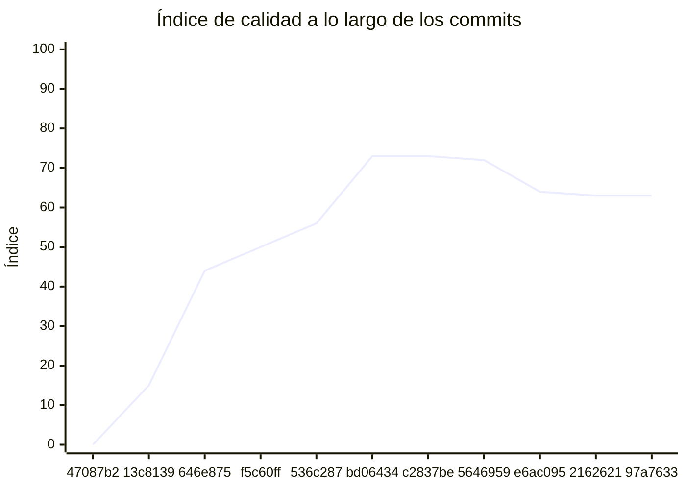

<!-- evaluacion:inicio -->
# Evaluación — TONEATTI-PROGRAMACION-TRABAJO-FINAL/Servicio-catalogo

> Documento **generado automáticamente** por la cátedra de Programación II (UM): RepoSense + análisis de calidad de **7 dimensiones**. **No editar a mano**: se regenera en cada evaluación.
> Rama evaluada: `main`. Análisis **heurístico** (regex + métricas) + build: es una criba para orientar la revisión, **no una nota**. La **documentación** del repositorio no se evalúa.
> Generado: 2026-11-20.

## 1. Veredicto

| Aspecto | Resultado |
|---|---|
| Índice de calidad | **74/100** |
| Tipo de repositorio | `backend` |
| Build (`mvnw verify` / `gradlew check`) | OK |
| Código (LOC) | 5,875 |
| Archivos de código | 169 |
| Clases | 174 |
| Código dentro de clases (%POO) | 62% |
| Funciones fuera de clases | 0 |
| Duplicación (puerta) | 0.7% |
| Duplicación lógica | 0.8% |
| Duplicación de boilerplate | 10.0% |
| Cobertura | 96% |
| Tope duro aplicado a D1 | `POO_BAJO` → D1 ≤ 60 |

> Este informe **describe** lo que el análisis midió con los criterios ya establecidos de la materia. No es una nota.

## 2. Semáforo de aprobación

Criterios de la cátedra (`CRITERIOS-CALIDAD.md`): **Aprobar** se juega con el perfil `estandar`; **destacar**, con el `exigente` (meta de excelencia).

| Semáforo | Resultado |
|---|---|
| Aprobar (`estandar`) | **cumple** — 8/11 |
| Destacar (`exigente`) | **no cumple** — 6/11 |

**Para destacar, falta cumplir:** SOLID; POO

## 3. Autoría (RepoSense)

| Autor | Commits | Código (LOC) | Tests (LOC) | Docs (LOC) | Días activos | % del código |
|---|---:|---:|---:|---:|---:|---:|
| LucianoToneatti | 58 | 2,908 | 4,146 | 280 | 21 | 100% |

> _El LOC de autoría lo calcula RepoSense sobre el historial y puede diferir del LOC de código del análisis (que mira el estado de `main`)._

## 4. Dimensiones evaluadas

Cada dimensión indica **qué mide**, **por qué importa** y **tu resultado**. Cuando el puntaje queda por debajo de la referencia, se agregan preguntas para **investigar la causa** (no hay recetas).

| Dimensión | Peso | Puntaje |
|:--|--:|--:|
| **D1** Diseño OO, SOLID y patrones (20%) | 20% | 9 |
| **D2** Arquitectura hexagonal — backend (15%) | 15% | 100 |
| **D3** Frontend KMP: MVVM y buenas prácticas (10%) | 10% | N/A |
| **D4** Integración y contrato (10%) | 10% | 80 |
| **D5** Seguridad y robustez (10%) | 10% | 100 |
| **D6** Pruebas y cobertura (20%) | 20% | 100 |
| **D7** Proceso y entrega (15%) | 15% | 77 |

### D1. Diseño OO, SOLID y patrones (20%)

- **Qué mide:** Métricas orientadas a objetos (clases, métodos, campos, cohesión, acoplamiento, herencia) y proxies de SOLID, más patrones de diseño.
- **Por qué importa:** El eje de la materia es el buen uso de la POO y su arquitectura: un diseño con clases claras y poco acopladas es más fácil de entender, probar y cambiar.
- **Tu resultado:** **9/100**
- **Para investigar la causa:**
    - ¿Se pensó el modelo de clases antes de codificar o se agrupó después?
    - ¿Qué clases concentran muchas responsabilidades a la vez?
    - ¿Los colaboradores llegan como parámetros o se crean por dentro?

### D2. Arquitectura hexagonal — backend (15%)

- **Qué mide:** Separación en capas (dominio, puertos de entrada/salida, adaptadores) y dirección de las dependencias del backend.
- **Por qué importa:** Aislar el dominio de la infraestructura permite cambiar la base de datos, el framework o el transporte sin tocar las reglas de negocio.
- **Tu resultado:** **100/100**

### D4. Integración y contrato (10%)

- **Qué mide:** Cumplimiento del contrato de integración de la cátedra (formato de errores, paginación, autenticación, endpoints esperados).
- **Por qué importa:** Los servicios deben poder integrarse entre sí y con la app sin sorpresas; el contrato es lo que hacen cumplir las pruebas de integración.
- **Tu resultado:** **80/100**

### D5. Seguridad y robustez (10%)

- **Qué mide:** Credenciales embebidas, consultas SQL por concatenación, y presencia de config de entorno; aislamiento de secretos.
- **Por qué importa:** Un secreto en el repositorio o una consulta construida por concatenación son riesgos concretos, no hipotéticos.
- **Tu resultado:** **100/100**

### D6. Pruebas y cobertura (20%)

- **Qué mide:** Cantidad y resultado de pruebas y cobertura de línea (JaCoCo/Kover, Surefire/Failsafe) cuando hay build.
- **Por qué importa:** Las pruebas son la red de seguridad para refactorizar e integrar; la cobertura acota las zonas sin verificar.
- **Tu resultado:** **100/100**

### D7. Proceso y entrega (15%)

- **Qué mide:** Artefactos verificables de proceso/entrega: `compose`, `.env.example`, CI (`.github/workflows/`), `CODEOWNERS` y wrapper de build (`mvnw`/`gradlew`). **No** puntúa documentación.
- **Por qué importa:** Un proyecto que compila, se levanta y se valida solo es más fácil de revisar y de integrar en equipo.
- **Tu resultado:** **77/100**

## 5. Señales detectadas

El análisis encontró las siguientes señales, con el archivo y la línea donde se originan cuando están disponibles:

**Archivos con más señales**

| Archivo | Señales |
|---|---:|
| `src/main/java/com/toneatti/catalogo/synchronization/infrastructure/redis/adapter/RedisCatalogChangesRepositoryAdapter.java` | 6 |
| `src/main/java/com/toneatti/catalogo/synchronization/application/service/CatalogSynchronizationService.java` | 4 |
| `src/main/java/com/toneatti/catalogo/synchronization/infrastructure/kafka/config/CatalogUpdatedKafkaConfig.java` | 3 |
| `src/main/java/com/toneatti/catalogo/synchronization/infrastructure/startup/CatalogSyncOnStartupListener.java` | 2 |
| `src/main/java/com/toneatti/catalogo/synchronization/infrastructure/rest/adapter/RestCatedraRepositoryAdapter.java` | 2 |
| `src/main/java/com/toneatti/catalogo/config/CatedraIntegrationProperties.java` | 2 |
| `src/main/java/com/toneatti/catalogo/professional/infrastructure/persistence/adapter/JpaProfessionalRepositoryAdapter.java` | 1 |
| `src/main/java/com/toneatti/catalogo/professional/infrastructure/web/controller/ProfessionalController.java` | 1 |
| `src/main/java/com/toneatti/catalogo/synchronization/infrastructure/rest/dto/CatedraSnapshotResponse.java` | 1 |
| `src/main/java/com/toneatti/catalogo/synchronization/infrastructure/kafka/listener/CatalogUpdatedListener.java` | 1 |

**DIP/concretos** (20)
- clase 'CatedraIntegrationProperties' muy acoplada (CBO=11) — `src/main/java/com/toneatti/catalogo/config/CatedraIntegrationProperties.java:24`
- clase 'CatedraRedisConfig' muy acoplada (CBO=11) — `src/main/java/com/toneatti/catalogo/config/CatedraRedisConfig.java:18`
- clase 'JpaProfessionalRepositoryAdapter' muy acoplada (CBO=8) — `src/main/java/com/toneatti/catalogo/professional/infrastructure/persistence/adapter/JpaProfessionalRepositoryAdapter.java:18`
- clase 'ProfessionalController' muy acoplada (CBO=9) — `src/main/java/com/toneatti/catalogo/professional/infrastructure/web/controller/ProfessionalController.java:22`
- clase 'JpaProfessionalCategoryRepositoryAdapter' muy acoplada (CBO=8) — `src/main/java/com/toneatti/catalogo/professionalcategory/infrastructure/persistence/adapter/JpaProfessionalCategoryRepositoryAdapter.java:18`
- clase 'CatalogSynchronizationService' muy acoplada (CBO=34) — `src/main/java/com/toneatti/catalogo/synchronization/application/service/CatalogSynchronizationService.java:36`
- clase 'CatalogSynchronizationService' instancia 3 concretos (CBO=34) — `src/main/java/com/toneatti/catalogo/synchronization/application/service/CatalogSynchronizationService.java:36`
- clase 'ApplyCatalogSnapshotUseCaseImpl' muy acoplada (CBO=8) — `src/main/java/com/toneatti/catalogo/synchronization/application/usecases/ApplyCatalogSnapshotUseCaseImpl.java:21`
- clase 'RecordProcessedCatalogEventUseCaseImpl' muy acoplada (CBO=9) — `src/main/java/com/toneatti/catalogo/synchronization/application/usecases/RecordProcessedCatalogEventUseCaseImpl.java:23`
- clase 'CatalogUpdatedKafkaConfig' muy acoplada (CBO=29) — `src/main/java/com/toneatti/catalogo/synchronization/infrastructure/kafka/config/CatalogUpdatedKafkaConfig.java:30`
- clase 'CatalogUpdatedListener' muy acoplada (CBO=11) — `src/main/java/com/toneatti/catalogo/synchronization/infrastructure/kafka/listener/CatalogUpdatedListener.java:24`
- clase 'JpaProcessedCatalogEventRepositoryAdapter' muy acoplada (CBO=9) — `src/main/java/com/toneatti/catalogo/synchronization/infrastructure/persistence/adapter/JpaProcessedCatalogEventRepositoryAdapter.java:17`
- clase 'RedisCatalogChangesRepositoryAdapter' muy acoplada (CBO=31) — `src/main/java/com/toneatti/catalogo/synchronization/infrastructure/redis/adapter/RedisCatalogChangesRepositoryAdapter.java:31`
- clase 'RedisCatalogChangesRepositoryAdapter' instancia 4 concretos (CBO=31) — `src/main/java/com/toneatti/catalogo/synchronization/infrastructure/redis/adapter/RedisCatalogChangesRepositoryAdapter.java:31`
- clase 'RestCatedraRepositoryAdapter' muy acoplada (CBO=19) — `src/main/java/com/toneatti/catalogo/synchronization/infrastructure/rest/adapter/RestCatedraRepositoryAdapter.java:24`
- clase 'RestCatedraRepositoryAdapter' instancia 4 concretos (CBO=19) — `src/main/java/com/toneatti/catalogo/synchronization/infrastructure/rest/adapter/RestCatedraRepositoryAdapter.java:24`
- clase 'CatalogSyncPoller' muy acoplada (CBO=11) — `src/main/java/com/toneatti/catalogo/synchronization/infrastructure/scheduling/CatalogSyncPoller.java:28`
- clase 'CatalogSyncOnStartupListener' muy acoplada (CBO=13) — `src/main/java/com/toneatti/catalogo/synchronization/infrastructure/startup/CatalogSyncOnStartupListener.java:26`
- clase 'JpaWeeklyScheduleRepositoryAdapter' muy acoplada (CBO=8) — `src/main/java/com/toneatti/catalogo/weeklyschedule/infrastructure/persistence/adapter/JpaWeeklyScheduleRepositoryAdapter.java:18`
- clase 'WeeklyScheduleEntity' muy acoplada (CBO=11) — `src/main/java/com/toneatti/catalogo/weeklyschedule/infrastructure/persistence/entity/WeeklyScheduleEntity.java:24`

**SRP/responsabilidad** (16)
- método 'CatedraIntegrationProperties.CatedraIntegrationProperties' de 52 líneas — `src/main/java/com/toneatti/catalogo/config/CatedraIntegrationProperties.java:24`
- clase 'CatalogSynchronizationService' grande (LOC=117, métodos=6, campos=9) — `src/main/java/com/toneatti/catalogo/synchronization/application/service/CatalogSynchronizationService.java:36`
- clase 'CatalogSynchronizationService' con baja cohesión (7%) — `src/main/java/com/toneatti/catalogo/synchronization/application/service/CatalogSynchronizationService.java:36`
- método 'CatalogSnapshot.CatalogSnapshot' con 5 parámetros — `src/main/java/com/toneatti/catalogo/synchronization/domain/model/CatalogSnapshot.java:14`
- clase 'CatalogUpdatedKafkaConfig' con baja cohesión (0%) — `src/main/java/com/toneatti/catalogo/synchronization/infrastructure/kafka/config/CatalogUpdatedKafkaConfig.java:30`
- método 'CatalogUpdatedMessage.CatalogUpdatedMessage' con 6 parámetros — `src/main/java/com/toneatti/catalogo/synchronization/infrastructure/kafka/dto/CatalogUpdatedMessage.java:12`
- método 'CatalogUpdatedMessageMapper.toDomain' con complejidad 6 — `src/main/java/com/toneatti/catalogo/synchronization/infrastructure/kafka/mapper/CatalogUpdatedMessageMapper.java:18`
- clase 'RedisCatalogChangesRepositoryAdapter' grande (LOC=122, métodos=12, campos=10) — `src/main/java/com/toneatti/catalogo/synchronization/infrastructure/redis/adapter/RedisCatalogChangesRepositoryAdapter.java:31`
- clase 'RedisCatalogChangesRepositoryAdapter' con baja cohesión (12%) — `src/main/java/com/toneatti/catalogo/synchronization/infrastructure/redis/adapter/RedisCatalogChangesRepositoryAdapter.java:31`
- método 'RedisCatalogChangesRepositoryAdapter.currentItems' con 7 parámetros — `src/main/java/com/toneatti/catalogo/synchronization/infrastructure/redis/adapter/RedisCatalogChangesRepositoryAdapter.java:102`
- método 'RedisCatalogChangesRepositoryAdapter.currentItems' con complejidad 6 — `src/main/java/com/toneatti/catalogo/synchronization/infrastructure/redis/adapter/RedisCatalogChangesRepositoryAdapter.java:102`
- método 'CatedraSnapshotResponse.CatedraSnapshotResponse' con 5 parámetros — `src/main/java/com/toneatti/catalogo/synchronization/infrastructure/rest/dto/CatedraSnapshotResponse.java:13`
- método 'CatedraProfessionalCategoryResponse.CatedraProfessionalCategoryResponse' con 6 parámetros — `src/main/java/com/toneatti/catalogo/synchronization/infrastructure/shared/dto/CatedraProfessionalCategoryResponse.java:5`
- método 'CatedraProfessionalResponse.CatedraProfessionalResponse' con 7 parámetros — `src/main/java/com/toneatti/catalogo/synchronization/infrastructure/shared/dto/CatedraProfessionalResponse.java:5`
- método 'CatedraWeeklyScheduleResponse.CatedraWeeklyScheduleResponse' con 9 parámetros — `src/main/java/com/toneatti/catalogo/synchronization/infrastructure/shared/dto/CatedraWeeklyScheduleResponse.java:10`
- clase 'CatalogSyncOnStartupListener' con baja cohesión (40%) — `src/main/java/com/toneatti/catalogo/synchronization/infrastructure/startup/CatalogSyncOnStartupListener.java:26`

**OCP/type-switch** (1)
- clase 'CatalogUpdatedKafkaConfig' con 1 type-checks — `src/main/java/com/toneatti/catalogo/synchronization/infrastructure/kafka/config/CatalogUpdatedKafkaConfig.java:30`

## 6. Evolución por commit

Métricas calculadas sobre el estado de `main` en **cada commit** (11 commits con trabajo), del primero al último. La calidad usa el perfil `exigente`; el aporte de código lo mide RepoSense. El índice puede **bajar** al crecer el proyecto: se acumulan señales.

| # | Fecha | Commit | Autor | LOC | Índice | %POO | Duplic. | Sueltas |
|---|---|---|---|---:|---:|---:|---:|---:|
| 1 | 2026-09-10 | `47087b2` | LucianoToneatti | 0 | 0 | 0% | 0.0% | 0 |
| 2 | 2026-09-15 | `13c8139` | Ing. Daniel Quinteros | 0 | 15 | 0% | 0.0% | 0 |
| 3 | 2026-10-13 | `646e875` | LucianoToneatti | 845 | 44 | 61% | 6.4% | 0 |
| 4 | 2026-10-20 | `f5c60ff` | LucianoToneatti | 983 | 50 | 65% | 7.0% | 0 |
| 5 | 2026-10-21 | `536c287` | LucianoToneatti | 827 | 56 | 64% | 1.9% | 0 |
| 6 | 2026-10-22 | `bd06434` | LucianoToneatti | 1,646 | 73 | 60% | 1.0% | 0 |
| 7 | 2026-10-23 | `c2837be` | LucianoToneatti | 1,646 | 73 | 60% | 1.0% | 0 |
| 8 | 2026-11-01 | `5646959` | LucianoToneatti | 1,836 | 72 | 59% | 2.5% | 0 |
| 9 | 2026-11-03 | `e6ac095` | LucianoToneatti | 3,400 | 64 | 60% | 1.3% | 0 |
| 10 | 2026-11-12 | `2162621` | LucianoToneatti | 5,784 | 63 | 62% | 0.7% | 0 |
| 11 | 2026-11-14 | `97a7633` | LucianoToneatti | 5,875 | 63 | 62% | 0.7% | 0 |

---
_Informe generado por la cátedra. Las dimensiones y umbrales corresponden a `calidad.py` (perfil `exigente`); el semáforo, a `CRITERIOS-CALIDAD.md`. La documentación del repositorio no se evalúa. Ante dudas, revisá el archivo señalado._
<!-- evaluacion:fin -->
